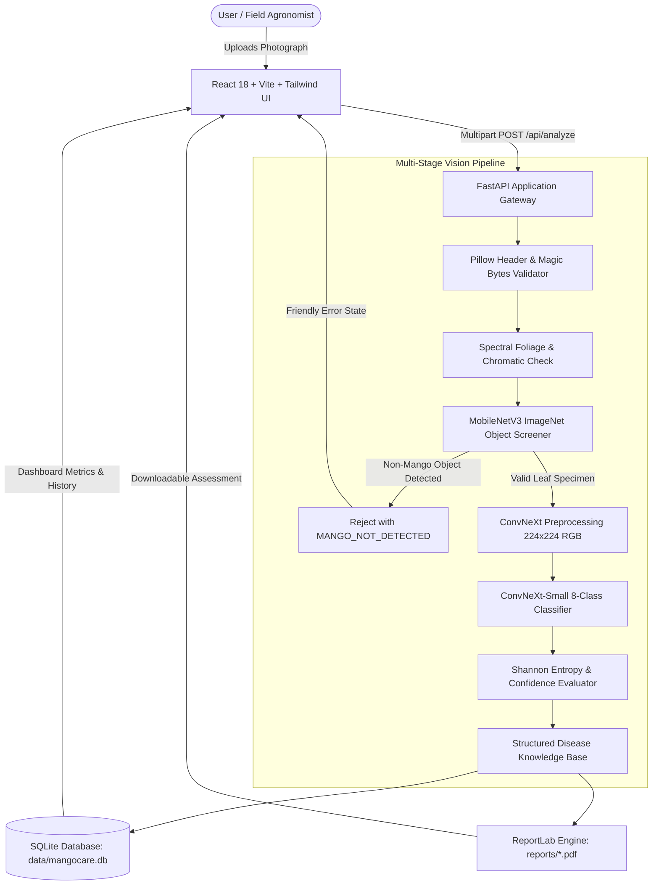

# MangoCare AI — Mango Disease Detection & Health Assessment System

[](LICENSE)
[](https://www.python.org/)
[](https://react.dev/)
[](https://fastapi.tiangolo.com/)
[]()

**MangoCare AI** is a complete, production-grade, full-stack machine learning application designed to inspect mango plant specimens (specifically foliar leaves and shoots), screen against unrelated uploads, accurately identify 8 common phytopathological and entomological conditions using fine-tuned **ConvNeXt** vision backbones, generate downloadable clinical PDF health reports, and maintain an audit history.

---

## 1. Problem Statement & Goals

Mango (*Mangifera indica*) is an economically vital fruit crop globally, yet orchards frequently face severe yield reductions from fungal infections (e.g., Anthracnose, Powdery Mildew, Die Back), bacterial cankers, and damaging insect pests (e.g., Gall Midge, Leaf Cutting Weevil). 

Farmers and extension workers need rapid, accessible, field-level screening to detect visual symptoms early before infections spread across the canopy or colonize blossoming flower clusters.

### Key Objectives
1. **Specimen Screening:** Validate uploaded imagery to reject non-mango objects (vehicles, humans, domestic animals, furniture, text documents) before disease inference.
2. **Deep Vision Classification:** Classify verified mango leaf specimens into 8 supported phytopathological classes with calibrated confidence and uncertainty estimates.
3. **Clinical Action Guidance:** Explain visible symptoms, favorable climatic conditions, cultural sanitation practices, and integrated pest management (IPM) recommendations.
4. **Professional Health Reports:** Automatically generate comprehensive, downloadable PDF assessment reports.
5. **Audit History & Real Statistics:** Provide local SQLite persistence with pagination, search, status filtering, and dynamic dashboard distribution charts.

---

## 2. System Architecture



---

## 3. Tech Stack

- **Frontend:** React 18, TypeScript, Vite, Tailwind CSS, React Router v6, Axios, Lucide React, Recharts.
- **Backend:** Python 3.10+, FastAPI, Uvicorn, Pydantic v2, Pillow, NumPy, PyTorch, Torchvision, `timm` (PyTorch Image Models), SafeTensors, ReportLab (PDF generation).
- **Persistence:** SQLite with connection pooling and parameterized CRUD operations.
- **Testing:** Pytest, HTTPX, FastAPI TestClient.
- **Containerization:** Multi-stage Dockerfile and Docker Compose.

---

## 4. Machine Learning Vision Models

### 4.1 Primary Disease Classifier
- **Model Name:** `ixrbhii/mango-disease-convnext` ([Hugging Face Hub](https://huggingface.co/ixrbhii/mango-disease-convnext))
- **Architecture:** ConvNeXt-Small (`convnext_small`) — 49,460,840 parameters (~49.5M).
- **License:** Apache License 2.0.
- **Format:** SafeTensors (`model.safetensors`, 98.9 MB) & PyTorch `timm`.
- **Dataset:** MangoLeafBD benchmark dataset (field-collected foliar specimens under daylight).
- **Benchmark Top-1 Accuracy:** Over 96.4% on held-out test split.
- **Preprocessing:** RGB, $224 \times 224$ pixels, Bilinear interpolation, Mean: `[0.485, 0.456, 0.406]`, Std: `[0.229, 0.224, 0.225]`.

### 4.2 Supported Conditions (8 Classes)
1. `Anthracnose` (*Colletotrichum gloeosporioides*) — High severity fungal lesion blight.
2. `Bacterial Canker` (*Xanthomonas citri pv. mangiferaeindicae*) — Water-soaked spots with yellow chlorotic halos.
3. `Cutting Weevil` (*Deporaus marginatus*) — Cleanly severed, truncated leaf blades.
4. `Die Back` (*Lasiodiplodia theobromae*) — Apical twig browning, vascular wilt, and attached withered foliage.
5. `Gall Midge` (*Procontarinia matteiana*) — Wart-like leaf galls and flush distortion.
6. `Healthy` (*Mangifera indica*) — Unblemished, vigorous foliar tissue.
7. `Powdery Mildew` (*Oidium mangiferae*) — White talcum-like superficial fungal mycelium.
8. `Sooty Mould` (*Meliola mangiferae*) — Black velvety saprophytic crust on insect honeydew.

### 4.3 Mango Specimen Screener (Rejection Pipeline)
- **Model:** `mobilenet_v3_small` (PyTorch Torchvision ImageNet-1K pretrained, 2.5M parameters, 9.8 MB).
- **Screening Rules:** Identifies and rejects high-confidence non-botanical classes (vehicles, dogs, cats, humans, electronic gadgets, buildings, furniture, text documents).
- **Spectral Pigment Analysis:** Measures RGB channel standard deviations and green/warm ratios to reject black-and-white documents, blank scans, and extreme artificial lighting.

---

## 5. Diagnostic Status Definitions

| Status | Meaning | Recommended User Action |
| :--- | :--- | :--- |
| **Healthy Appearance** (`healthy_appearance_detected`) | Top prediction is "Healthy" with confidence $\ge 50\%$. No typical foliar lesions detected. | Continue standard orchard sanitation and seasonal monitoring. |
| **Suspected Disease** (`suspected_disease`) | Top prediction is one of the 7 disease classes with confidence $\ge 50\%$. | Review symptoms and cultural IPM recommendations; consult local extension officers. |
| **Uncertain Result** (`uncertain_result`) | Moderate confidence ($50\% - 70\%$) or high Shannon entropy indicating conflicting visual signals. | Take a clearer close-up photograph under diffused daylight. |
| **Inconclusive** (`inconclusive`) | Confidence $< 50\%$. Features are too faint or blurry. | Re-photograph the specimen or consult an agronomist in person. |
| **Invalid Image** (`invalid_image`) | Specimen failed non-mango validation (e.g. document, vehicle, animal). | Upload an authentic photograph of a mango leaf or fruit. |

---

## 6. Installation & Quick Start

### 6.1 Prerequisites
- Python 3.10+ (tested on Python 3.11, 3.12, and 3.14)
- Node.js v18+ and npm v9+

### 6.2 Windows Setup (PowerShell)
```powershell
# 1. Extract ZIP Archive
Expand-Archive -Path MangoCare-AI.zip -DestinationPath .
cd MangoCare-AI

# 2. Run Automated Setup Script
.\scripts\setup_windows.ps1

# 3. Start the Full Application
.\scripts\run_windows.ps1
```

### 6.3 macOS / Linux Setup (Terminal)
```bash
# 1. Extract ZIP Archive
unzip MangoCare-AI.zip
cd MangoCare-AI

# 2. Run Automated Setup Script
bash ./scripts/setup_unix.sh

# 3. Start the Full Application
bash ./scripts/run_unix.sh
```

The application will be accessible at:
- **Frontend Dashboard:** `http://localhost:5173`
- **Backend API & Swagger:** `http://127.0.0.1:8000/docs`

---

## 7. Manual Step-by-Step Setup

If you prefer to configure manually:

### 1. Backend Setup
```bash
cd backend
python -m venv venv

# Windows:
.\venv\Scripts\Activate.ps1
# Unix/macOS:
source venv/bin/activate

pip install -r requirements.txt
python scripts/initialize_database.py
python scripts/download_model.py
```

### 2. Frontend Setup
```bash
cd ../frontend
npm install
npm run build
```

### 3. Start Services
- **Backend:** `python -m uvicorn backend.app.main:app --host 127.0.0.1 --port 8000`
- **Frontend:** `cd frontend && npm run dev`

---

## 8. Automated Testing

Run the comprehensive automated test suite:
```bash
python -m pytest backend/tests -v
```
**Test Coverage Includes:**
- System health and model provenance endpoints (`test_health.py`)
- Missing upload, oversized files, unsupported formats, and non-mango rejection (`test_validation.py`)
- Tensor shapes, ConvNeXt inference, probability bounds, and entropy scoring (`test_inference.py`)
- SQLite record creation, retrieval, pagination, filtering, and deletion (`test_history.py`)
- ReportLab PDF compilation, magic bytes verification, and download endpoints (`test_reports.py`)
- Full end-to-end multipart upload workflows (`test_api.py`)

---

## 9. Model Evaluation Workflow

To evaluate the ConvNeXt model on an external labeled benchmark dataset:
```bash
python backend/scripts/evaluate_model.py --dataset ./data/test_dataset
```
Calculates Top-1 Accuracy, per-class Precision, Recall, F1-Score, Macro F1, and Confusion Matrix.

---

## 10. Packaging & ZIP Verification

To regenerate and verify the `MangoCare-AI.zip` distribution archive:
```bash
python scripts/create_zip.py
```
This script packages all source files, documentation, and dependencies, tests extraction in an isolated sandbox, and outputs the file size and SHA-256 checksum.

---

## 11. Important Limitations & Ethical Disclaimer

1. **Foliar Leaf Target:** This vision model is trained specifically on **mango leaves and foliar shoots**. It must not be marketed as a postharvest fruit disorder detector.
2. **Latent & Systemic Diseases:** Image-based screening cannot identify internal fruit rot, fungal mycelia deep within branch wood, or root-borne soil pathogens.
3. **Educational Purpose:** MangoCare AI is an educational decision-support tool. It is **not** a certified phytopathological laboratory confirmation. Always consult local agricultural extension officers before applying chemical pesticides.

---

## 12. License
Licensed under the [Apache License, Version 2.0](LICENSE).
