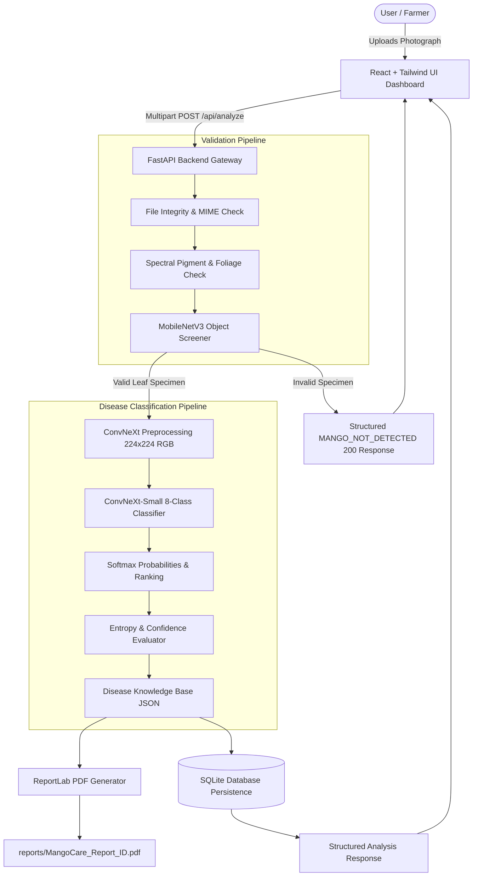

# MangoCare AI — System Architecture & Design

## 1. High-Level Architecture Overview

MangoCare AI is an end-to-end full-stack computer vision application designed for automated mango foliar pathology screening. The system incorporates a dual-tier computer vision pipeline: an initial non-mango rejection filter and a fine-tuned ConvNeXt disease classifier.

---

## 2. Component Breakdown

### 2.1 Frontend Architecture (`frontend/`)
- **Technology:** React 18, TypeScript, Vite, Tailwind CSS, Lucide Icons, Recharts.
- **Routing:** React Router v6 client-side routing supporting:
  - `/` — Interactive dashboard with real SQLite statistical counters, disease distribution charts, and recent activity.
  - `/analyze` — Drag-and-drop file ingestion, client validation, resolution checking, progress status indicators, and photography guidance.
  - `/results` — Diagnostic results with color-coded status badges, confidence meters, uncertainty warnings, alternative predictions, symptoms checklist, and PDF report download.
  - `/library` — Searchable and filterable reference encyclopedia covering all 8 supported conditions.
  - `/history` — Paginated history table with search, status filters, report retrieval, and deletion.
  - `/about` — Transparent breakdown of model architectures, evaluation metrics, and constraints.

### 2.2 Backend Architecture (`backend/`)
- **Framework:** FastAPI with Uvicorn ASGI server.
- **Service Layer Pattern:** Clean separation between routes, business services, vision inference, and data repositories:
  - `app/api/routes/` — HTTP route definitions and input parsing.
  - `app/services/` — Business orchestration (`AnalysisService`, `ReportService`, `HistoryService`).
  - `app/ml/` — Machine learning inference, preprocessing, model loading, and confidence scoring.
  - `app/database/` — Parameterized SQLite persistence layer.
  - `app/knowledge/` — Agricultural disease knowledge base.
  - `app/utils/` — Decompression-bomb-safe Pillow transformations and magic byte validation.

### 2.3 Storage Layer
- **SQLite Persistence:** `data/mangocare.db` stores analysis metadata, confidence scores, condition names, and report pointers.
- **Privacy Conscious:** Raw uploaded images are processed in-memory or converted into safe thumbnails for PDF embedding without retaining high-resolution personal imagery.
